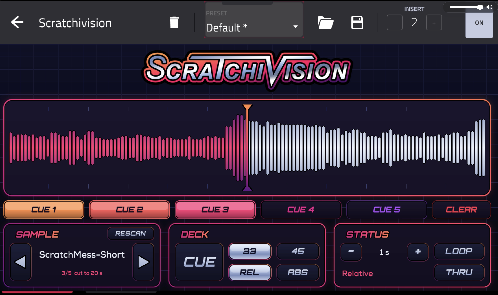
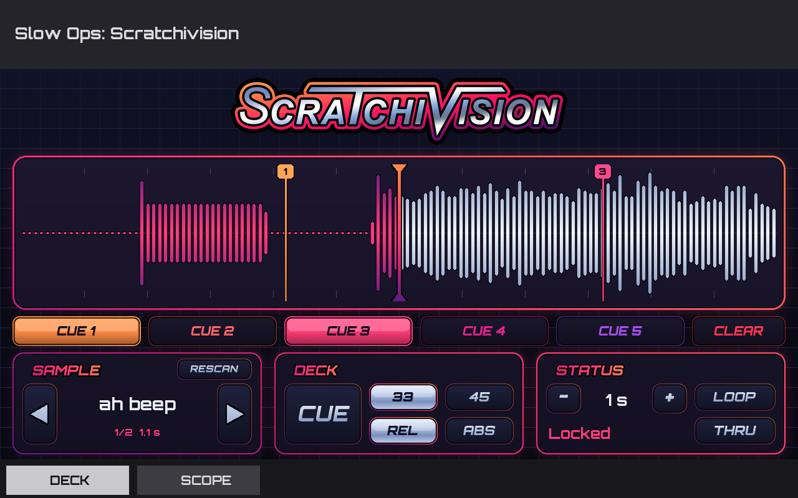
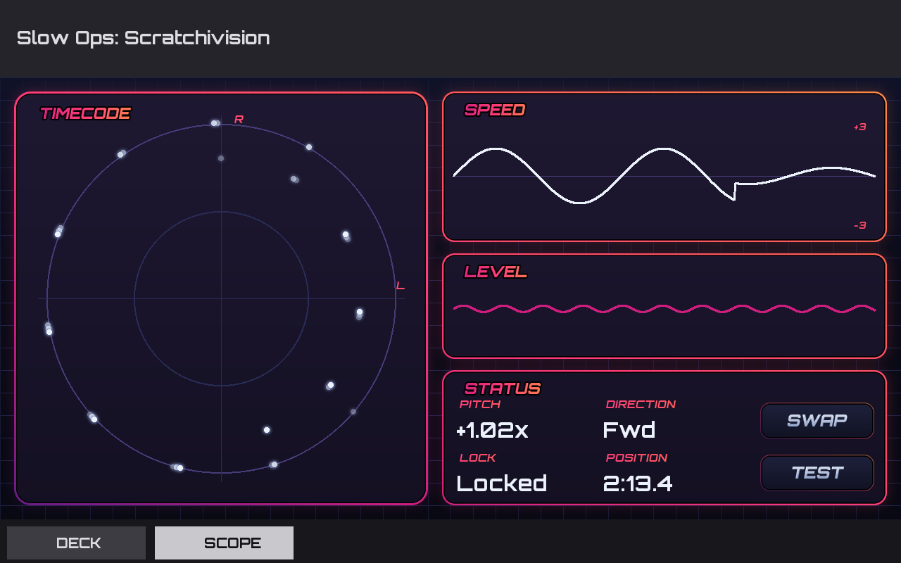

# SlowOps.Scratchivision

Scratchivision is an MPC plugin (MPC OS 3.10.1+, built for the MPC XL) that turns a turntable
with Serato-style control vinyl into a scratch controller for a sample. It is an insert effect:
timecode audio goes into the track, the scratched sample comes out.



*The DECK page on an MPC XL.*

| DECK (mock-up) | SCOPE (mock-up) |
|---|---|
|  |  |

The mock-ups are drawn on a computer by `scripts/make_skin_art.py`. On the MPC, the device draws
the readouts in its own font.

## Layout

| Path | What |
|---|---|
| `core/include/slowops/scratch/` | Header-only, no SDK dependency: `Lfsr.hpp` (bit sequence), `TimecodeDecoder.hpp`, `ScratchPlayer.hpp`, `ScratchEngine.hpp`, `SampleLibrary.hpp` (folder scan, loader thread), `AudioFile.hpp` (AIFF and MP3), `WaveBars.hpp` (live waveform), `TimecodeGen.hpp` (synthetic timecode for tests and Test mode) |
| `plugin/` | The MPC project: `plugin.json`, `src/Scratchivision.cpp` (thin adapter), `skins/` (generated TUI.json, Q-Links.json, PNGs), `README.md` (user manual) |
| `wav/` | The samples bundled with the plugin. Users add their own on the MPC, in `Scratchivision/` at the drive root |
| `images/logo.png` | The logo; the whole skin is styled after it |
| `scripts/` | `build.sh`, `test.sh`, `gen_samples.py`, `gen_skins.py`, `make_skin_art.py`, `skin_layout.py` |
| `tests/` | `core_tests.cpp` (decoder, player, engine), `scenario_host.cpp` (loads the real plugin binary, feeds it generated timecode) |
| `docs/` | `CONTROLS.md`, `SPIKE.md` (device checklist), preview images |
| `third_party/mpc-plugin-builder-sdk` | inMusic's MPC plugin SDK (MIT), submodule pinned at `febd2ca` |

## Build and test

```sh
git submodule update --init
./scripts/test.sh      # build (native, arm32, arm64), unit tests, host_sim, scenario host
```

The output is `plugin/build/Slow Ops - VST - Scratchivision/`. To install it, copy it into
`VST2 Plugins/` on an MPC drive and restart. You can also use the SDK's
`tools/mpc_remote.py <ip> update plugin --drive N --yes` with the MPC's developer mode on.

**Bundled samples:** put WAVs in `./wav` and rebuild. Users add their own on the MPC (see
`plugin/README.md`).

**Changing the look:** regenerate the art. It needs Pillow:

```sh
python3 -m venv build/venv && build/venv/bin/pip install pillow
build/venv/bin/python scripts/make_skin_art.py
./scripts/build.sh
```

## How it works

- **Timecode:** a 1 kHz carrier on L and R, a quarter cycle apart. Each carrier cycle carries
  one bit of a 20-bit LFSR sequence, sent as loud or quiet.
  - **Speed** comes from zero-crossing timing.
  - **Direction** comes from which channel leads.
  - **Absolute position** comes from looking up 20 consecutive bits in a 4 MB table. It locks
    after 12 lookups agree, about 35 ms at normal speed.
- **Decoder origin:** written from the format description. No xwax or other GPL code.
- **Player:** 4-point Hermite interpolation at a variable signed speed. It also has a DC
  blocker and a 5 ms gate, so a held platter is silent.
- **Display (the MPC can't draw from plugin code):**
  - **Waveform:** 128 film-strip bars. The plugin fills them from the loaded sample's envelope around the play position, so any WAV gets a waveform without a pre-rendered image.
  - **Scope:** 32 XYPad dots.
  - **Speed and level:** Plotter traces.
  - **Feed:** the plugin writes read-only parameters at about 30 Hz.
  - See `docs/SPIKE.md` for what has to be confirmed on the device.

## Limits of this version

- **No file browser.** The MPC gives plugins no file browser, so samples come from `Scratchivision/` folders at drive roots: up to 64 files (WAV, AIFF, MP3), 20 s each, loaded one at a time.
- **Format support.** Only Serato CV02 side A at 33 or 45, for now.

## Licence

MIT. MP3 decoding: minimp3 by lieff (CC0 1.0, `third_party/minimp3/`). Font: Orbitron, SIL OFL 1.1 (`assets/fonts/OFL.txt`), used only to draw text into the skin
PNGs.
